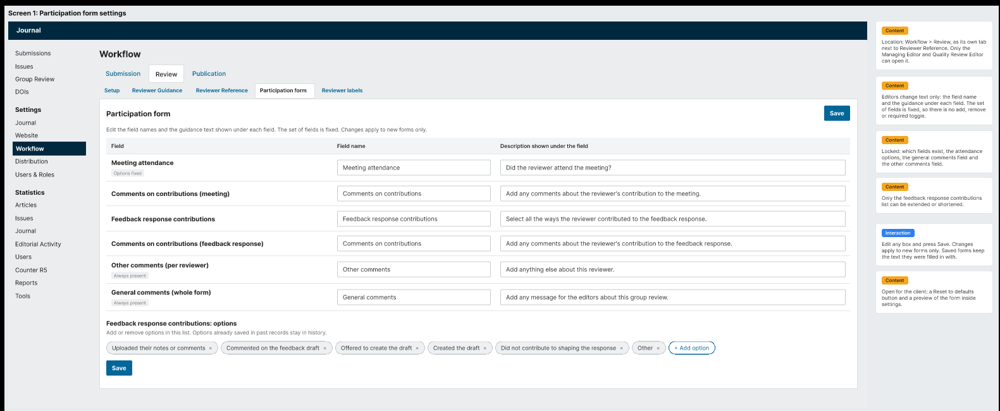
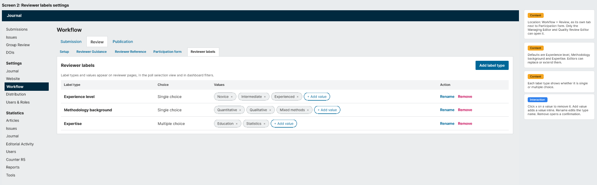
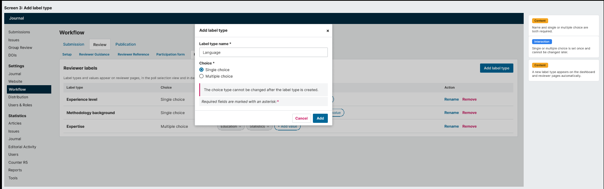
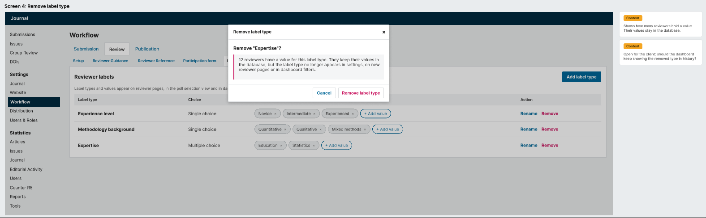

# Configuration Wireframe Validation

**Creator:** Jahan Haidari (BA)

**Team:** 77

**Task:** Validation of configuration wireframes

---

## 1. Task Scope

This document validates the configuration wireframes against the configuration requirements document. The wireframes were produced by UX and show how editors configure the participation form and reviewer labels.

The validation checks whether each configurable item is represented in the wireframes and whether anything is missing or added beyond the requirements.

---

## 2. Screens Reviewed

### 2.1 Participation Form Settings

The settings page where editors edit form text and manage feedback response contribution options.

### 2.2 Reviewer Labels Settings

The settings page where editors manage label types and their values.

### 2.3 Add Label Type

The modal for creating a new label type.

### 2.4 Remove Label Type

The modal for removing a label type.

---

## 3. Field by Field Validation

### 3.1 Form Text Editing

| Requirement | Status | Evidence |
|-------------|--------|----------|
| Editors can edit the field name | Pass | Screen 2.1 shows text boxes for each field name |
| Editors can edit the description under each field | Pass | Screen 2.1 shows text boxes for each description |
| Field set is fixed | Pass | Fields are listed but cannot be added, removed, or reordered |
| Other comments marked as always present | Pass | Screen 2.1 shows "Always present" under the field |
| General comments marked as always present | Pass | Screen 2.1 shows "Always present" under the field |

### 3.2 Feedback Response Contributions

| Requirement | Status | Evidence |
|-------------|--------|----------|
| Editors can add options | Pass | Screen 2.1 shows a "+ Add option" button |
| Editors can remove options | Pass | Screen 2.1 shows an X on each option tag |
| Default options present | Pass | All six default options shown |

### 3.3 Reviewer Labels

| Requirement | Status | Evidence |
|-------------|--------|----------|
| Editors can add a label type | Pass | Screen 2.2 shows "+ Add label type" button |
| Editors can rename a label type | Pass | Screen 2.2 shows Rename action |
| Editors can remove a label type | Pass | Screen 2.2 shows Remove action |
| Editors can add values inside a label type | Pass | Screen 2.2 shows "+ Add value" for each type |
| Editors can remove values inside a label type | Pass | Screen 2.2 shows X on each value tag |
| Label types show single or multiple choice | Pass | Screen 2.2 shows the Choice column |
| Default label types present | Pass | Experience level, Methodology background, Expertise |

### 3.4 Placement and Integration

| Requirement | Status | Evidence |
|-------------|--------|----------|
| Configuration lives under Workflow > Review | Pass | Screens 2.1 and 2.2 show the Workflow > Review tab |
| Participation form is its own tab | Pass | Visible in screen 2.1 next to Reviewer Reference |
| Reviewer labels is its own tab | Pass | Visible in screen 2.2 next to Participation form |
| Only editors can open it | Pass | Noted in the content boxes on both screens |

### 3.5 Add Label Type Modal

| Requirement | Status | Evidence |
|-------------|--------|----------|
| Label type name field | Pass | Screen 2.3 shows a text field |
| Single or multiple choice selection | Pass | Screen 2.3 shows radio buttons |
| Choice cannot be changed after creation | Pass | Screen 2.3 shows a warning message |

### 3.6 Remove Label Type Modal

| Requirement | Status | Evidence |
|-------------|--------|----------|
| Confirmation before removal | Pass | Screen 2.4 shows a confirmation modal |
| Shows how many reviewers have the value | Pass | Screen 2.4 says 12 reviewers have a value |
| Values stay in the database | Pass | Screen 2.4 explains this |
| Label stops appearing in settings, new reviewer pages, and dashboard filters | Pass | Screen 2.4 explains this |

---

## 4. Gaps Found

No gaps found against the requirements document.

---

## 5. What Works Well

The placement under Workflow > Review is a good match for the OJS integration requirement. Editors will find the settings in the same place they manage other review settings.

The participation form settings page uses a clean table layout with each field, its name, and its description in one row. Editors can see everything on one screen without scrolling between pages.

The feedback response contribution options are shown as removable tags with an X. This makes it obvious what can be removed and what is currently active.

The reviewer labels page shows the choice type clearly in its own column. This makes it easy to see at a glance which labels allow one value and which allow many.

The Add label type modal warns that the choice type cannot be changed after creation. This prevents editors from making mistakes.

The Remove label type modal is honest about what happens to existing data. It tells the editor that values stay in the database but the label stops appearing in the settings and dashboard.

The notes on the side of each screen give useful context for the client and reviewers of the design.

---

## 6. What Was Added Beyond the Requirements

These items are in the wireframes but were not in the requirements document.

| Feature | Where | Notes |
|---------|-------|-------|
| Reset to defaults button | Screen 2.1 (noted as open for the client) | Would let editors undo all form text changes |
| Preview of the form inside settings | Screen 2.1 (noted as open for the client) | Would let editors see changes before saving |

Both of these are marked in the wireframes as open questions for the client. They should either be added to the requirements or removed from the wireframes once the client decides.

---

## 7. Open Questions Raised by the Wireframes

| Question | Where raised | Who to ask |
|----------|--------------|------------|
| Should there be a reset to defaults button? | Screen 2.1 | Client |
| Should there be a preview of the form inside settings? | Screen 2.1 | Client |
| Should the dashboard keep showing a removed label type in history? | Screen 2.4 | Client |

---

## 8. Overall Decision

The wireframes meet the requirements from the PM and match the configuration requirements document.

Every configurable item is represented. Every locked item is respected. The placement under Workflow > Review matches the integration requirement.

The wireframes are approved.

---

## 9. Recommendations for UX

| Item | Priority |
|------|----------|
| Confirm with the client whether the reset button and preview are wanted | Low |
| Confirm with the client what happens to removed label types in dashboard history | Low |

---

## 10. Sign Off

| Role | Name | Status | Date |
|------|------|--------|------|
| BA | Jahan Haidari | Approved | 16 October 2026 |

---